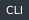
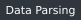
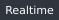
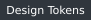
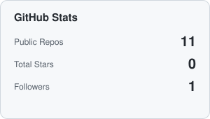
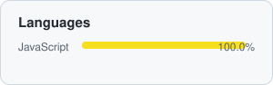
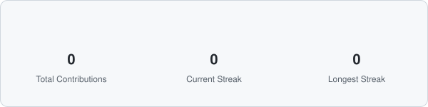

<em>"Crafting clean code and thoughtful, functional interfaces that are a joy to use every single day."</em>

 

## 💻 About Me

I'm a Software Engineer who likes turning ideas into clean, usable products — from the interface a user touches to the logic running behind it. I care equally about **DX (Developer Experience)** and **UI/UX**, because a good system should feel as effortless to build on as it is to use.

- 🎨 **Interfaces** — Minimalism, micro-interactions, and layouts that get out of the user's way.
- 🧩 **Architecture** — Readable, well-structured code across a React frontend and a Node.js / Django backend.
- 🚀 **Automation** — Scripts and tools that remove repetitive work for myself and other developers.

 

## 🛠️ Technical Toolkit

**Frontend & UI/UX**

**Backend & Scripting**

📐 Focus areas (click to expand)

 

| Layer    | Focus                                                             |
| :------- | :----------------------------------------------------------------- |
| Frontend | Micro-interactions, Responsive Layouts, Component Architecture   |
| Backend  | API Design, Data Parsing, Automation Scripts                     |

 

## 📌 Featured Projects

Here are some selected tools where I focused heavily on seamless interactions and practical utility:

| Project                                                                       | Description                                                                                                                                                                        | Stack                                                                                                                                                                                                                                                                                                 |
| :----------------------------------------------------------------------------- | :----------------------------------------------------------------------------------------------------------------------------------------------------------------------------------- | :----------------------------------------------------------------------------------------------------------------------------------------------------------------------------------------------------------------------------------------------------------------------------------------------------- |
| [**ArcBookmarksConverter**](https://github.com/MrFa1n/ArcBookmarksConverter) | 🗺️ A lightweight utility to convert Arc browser bookmarks (`StorableSidebar.json`) into a universal HTML format, allowing flawless imports into Chrome, Firefox, Safari, and Edge. |                                           |
| [**planningPokerLite**](https://github.com/MrFa1n/planningPokerLite)        | 🃏 Smart and elegant serverless Planning Poker. Features built-in timers, roles, and real-time syncing magic for agile teams without backend overhead.                             |                                  |
| [**fake-press**](https://github.com/MrFa1n/fake-press)                      | ⚡ A playground dedicated to UI micro-interactions, custom animations, and handling element active/pressed states.                                                                 |                                                                                                                  |

 

## 📊 GitHub Stats

 

Refreshed weekly by a <a href=".github/workflows/update-stats.yml">GitHub Action</a> running inside this repo — no third-party stats service is called when this page is viewed.

 

## 📫 Connect With Me

💬 Always open to interesting projects, architectural discussions, and UI/UX deep dives.

